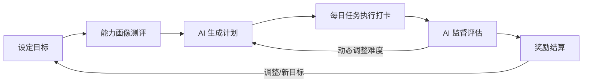
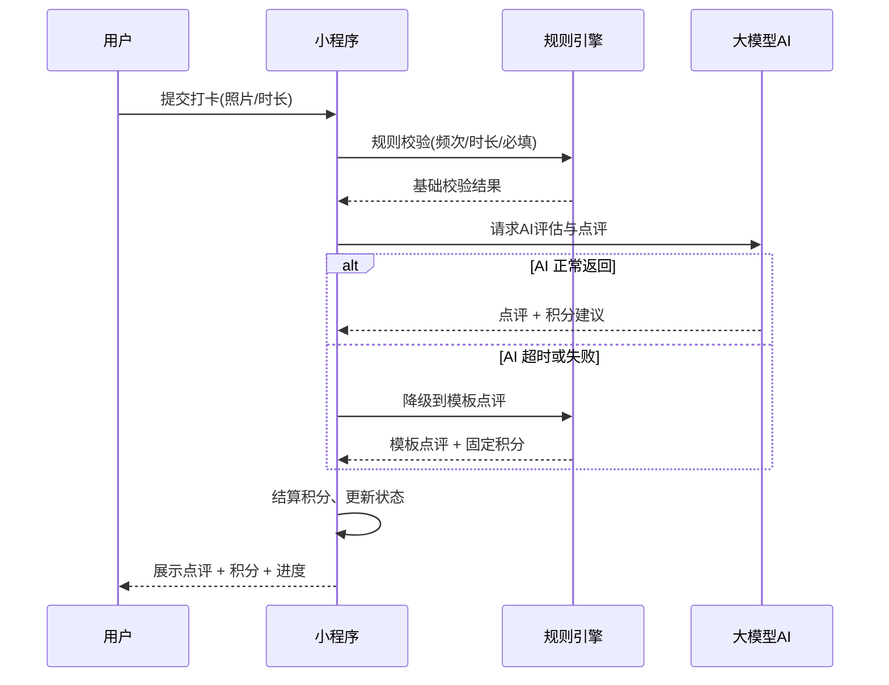
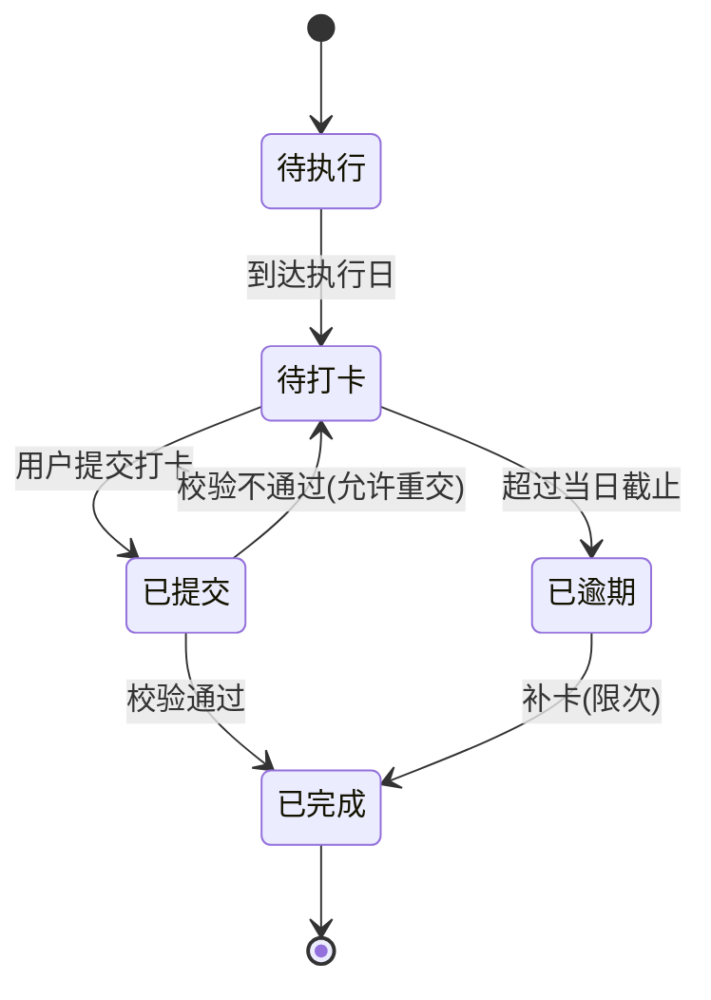

# AI 颜值/身材成长系统 · 微信小程序 PRD

文档日期：2026-11-25
产品形态：微信小程序
MVP 场景：颜值 / 身材提升
AI 方案：混合式（大模型 API + 规则引擎兜底）

> 标注约定：`[假设]` 表示本文推断、需产品确认；`[待确认]` 表示需补数据；`[V2]` 表示预留升级、本期不实现。

---

## 一、需求背景与目标

### 1.1 需求背景

用户想「变好看」或「变健康」时，普遍缺乏的不是动机，而是持续行动的机制。市面上的健身、护肤、阅读类产品大多是「工具 + 内容」，用户需要自己拆解目标、自己坚持，没有谁告诉他下一步做什么、做得对不对、离目标还有多远。结果是三分钟热度，App 装了又卸载。

本项目把「小说里的系统」这种设定产品化：用户设定一个方向，AI 帮他拆解成每天可执行的任务，监督他完成，评估他的进步，并用奖励和对话把他「留下来」。核心不是内容库，而是**一个会规划、会监督、会说话的个人成长教练**。

证据强度：用户痛点描述为 `[专家判断]`，具体留存/付费数据 `[待确认]`。

### 1.2 产品目标

一句话定位：一个「AI 驱动的颜值/身材成长教练」小程序，设定目标 → 定制计划 → 打卡 → AI 评估 → 奖励，让用户在正反馈中持续变好。

可量化目标（`[假设]`，上线后用真实数据校准）：

| 指标 | 目标值 | 观察期 |
|---|---|---|
| 次日留存 | ≥ 30% | 上线后 4 周 |
| 首周 7 天连续打卡完成率 | ≥ 40% | 上线后 4 周 |
| AI 每日点评打开率 | ≥ 50% | 上线后 4 周 |

### 1.3 差异化定位

对比「Keep / 咕咚」这类运动工具，本产品的重心不在动作教学，而在**个性化任务编排 + 过程监督 + 情感互动**。对比「薄荷健康」这类记录工具，本产品更强调「有人盯着你、有人给你反馈」的陪伴感。

---

## 二、用户与核心场景

### 2.1 用户画像

| 画像 | 特征 | 使用频率 | 付费能力 | 决策权 |
|---|---|---|---|---|
| 用户 A：职场新人女性，23 岁 | 想提升颜值/体态，自律差，需要外部监督，对「打卡发照片」有一定顾虑 | 每天 | 中等，愿为结果付费 | 自己决定 |
| 用户 B：程序员男性，28 岁 | 久坐体态差、想减脂增肌，喜欢游戏化反馈，接受数据记录 | 每天打卡，每周看报告 | 中等 | 自己决定 |

角色分离：V1 只有「普通用户」一种角色，无后台管理。`[V2]` 增加运营后台（内容/任务库管理）与审核角色。

### 2.2 核心场景（按优先级）

1. **首次设定目标**：新用户进入 → 做能力画像 → 选「颜值/身材」方向 → AI 生成计划 → 确认并开启。
2. **每日打卡**：打开「今日」页 → 完成任务 → 拍照/填时长打卡 → 收到 AI 点评和积分。
3. **AI 对话求助**：某天不想动，找「系统」聊天，AI 鼓励或换任务。
4. **看成长报告**：每周看一次报告，看到体态分/体能分变化，获得成就感。
5. **领取奖励**：连续打卡解锁徽章/称号，获得正向激励。

### 2.3 使用前置条件

用户需授权微信登录；打卡照片功能需授权相机/相册；`[V2]` 微信运动步数需授权微信运动。

---

## 三、功能需求

### 3.1 功能总览表

| # | 模块 | 功能描述 |
|---|---|---|
| F1 | 目标设定与能力画像 | 用户选择成长方向（颜值/身材），填写身高体重、当前作息、运动基础等画像信息，AI 据此生成可量化目标（如「3 个月体脂降 5%」）。画像决定任务难度初始值。 |
| F2 | AI 制定计划 | 根据目标与画像，AI 拆解出每日任务列表（跑步、俯卧撑、靠墙站、早睡、护肤等），每条任务带难度、时长、频次、积分。用户可手动调整任务或难度。 |
| F3 | 今日任务与打卡 | 「今日」页展示当天待办任务，用户完成任务后提交打卡（照片 + 实际时长）。打卡经过规则校验与 AI 评估后结算积分。 |
| F4 | AI 监督评估 | 对每次打卡给出点评；对打卡照片做场景识别（是否真的在运动/护肤）；每周生成成长报告；根据完成情况动态调整任务难度。 |
| F5 | 奖励与成长体系 | 积分、等级、连续打卡天数、徽章、称号。积分来自打卡，等级和徽章来自累计与里程碑，形成即时正反馈。 |
| F6 | AI 对话 | 拟人化「系统」人格，支持文字对话：问建议、吐苦水、请求换任务、查询进度。 |
| F7 | 成长报告 | 以数据可视化呈现体能分、体态分、作息分等维度的周/月变化曲线。 |
| F8 | 我的 | 目标管理、能力画像、隐私设置（照片授权）、奖励中心入口、关于/反馈。 |

### 3.2 核心流程

**整体成长循环**

**打卡与 AI 评估流程**

**任务状态机**

### 3.3 页面与模块详情

#### P1 今日任务首页（Tab1）

入口：底部导航「今日」。

页面结构（自上而下）：
- 顶部：日期 + 连续打卡天数（streak）+ 当前等级与积分。
- 中部：今日任务列表，每条任务卡片显示任务名、难度、预计时长、积分、完成状态。
- 底部：总进度条（今日完成 n / N）+「找 AI 聊聊」快捷入口。

| 控件/字段 | 类型 | 必填 | 规则/状态 |
|---|---|---|---|
| 连续打卡天数 | 数字展示 | — | 昨日已达标则 +1，中断则归 0 |
| 等级/积分 | 数字展示 | — | 来源 F5 积分体系 |
| 任务卡片 | 列表项 | — | 未完成 → 可点进入详情打卡；已完成 → 置灰打勾；已逾期 → 标红，可补卡 |
| 进度条 | 进度展示 | — | 完成数 / 总任务数 |
| 找 AI 聊聊 | 按钮 | — | 跳转 Tab2 对话页 |

交互逻辑：点击任务卡片进入 P5 任务详情；打卡成功后回到本页，卡片变已完成，进度条前进，积分即时增加并有动效提示。

边界状态：当日无任务 → 显示空态「AI 还没给你排任务，去对话页让它安排」；网络失败 → 顶部提示重试；任务全部完成 → 显示庆祝空态 + 分享引导。

#### P2 目标设定页

入口：首次登录自动进入；或「我的 → 目标」。

页面结构：
- 顶部：引导语「你想在哪个方向变好」。
- 中部：方向选择卡片（颜值 / 身材 / 体态 / 护肤 / 作息），可多选但 MVP 默认单选「颜值/身材」大类。
- 底部：「下一步」按钮。

| 控件/字段 | 类型 | 必填 | 规则/状态 |
|---|---|---|---|
| 方向选择 | 单选卡片 | 是 | 未选择时「下一步」置灰 |
| 下一步 | 主按钮 | — | 点击进入 P3 能力画像测评 |

#### P3 能力画像测评页

入口：P2 点击「下一步」。

采集字段（决定任务难度初始值）：

| 字段名 | 类型 | 必填 | 校验规则 |
|---|---|---|---|
| 性别 | 单选 | 是 | 男/女/保密 |
| 身高(cm) | 数字 | 是 | 100–250 |
| 体重(kg) | 数字 | 是 | 30–300 |
| 年龄 | 数字 | 否 | 10–100 |
| 运动基础 | 单选 | 是 | 几乎不/偶尔/每周1-3次/经常 |
| 作息 | 单选 | 否 | 熬夜/规律 |
| 目标量化 | 输入 | 否 | 如「减重 5kg」，长度 ≤ 50 字 |

交互逻辑：填写完成 → 点击「生成计划」→ 调 AI 生成 → 跳转 P4。

边界状态：AI 生成超时 → 降级用预设模板生成，并提示「已用基础方案，后续可让 AI 优化」。

#### P4 AI 计划确认页

入口：P3 生成计划后。

页面结构：
- 顶部：目标摘要（方向 + 量化目标）。
- 中部：AI 生成的计划列表（未来 N 天的任务，含每日任务、难度、时长、积分）。
- 底部：「就这么干」确认按钮 +「换一批」重新生成按钮。

| 控件/字段 | 类型 | 必填 | 规则/状态 |
|---|---|---|---|
| 计划列表 | 列表 | — | 每条任务可左滑删除/长按改难度 |
| 换一批 | 次按钮 | — | 重新调 AI 生成，每天限 3 次 |
| 就这么干 | 主按钮 | — | 保存计划，写入任务表，进入 P1 |

边界状态：计划为空 → 提示重试或联系反馈。

#### P5 任务详情页

入口：P1 点击任务卡片。

页面结构：
- 顶部：任务名 + 难度星级 + 积分值。
- 中部：任务说明（怎么做、注意点）、预计时长、频次。
- 底部：打卡按钮。

| 控件/字段 | 类型 | 必填 | 规则/状态 |
|---|---|---|---|
| 任务说明 | 文本 | — | 来源模板库或 AI 生成 |
| 打卡 | 主按钮 | — | 点击进入 P6；已逾期则显示「补卡」 |

#### P6 打卡确认页

入口：P5 点击「打卡」。

页面结构：
- 顶部：任务名。
- 中部：照片上传区（相机/相册）+ 实际时长输入。
- 底部：提交按钮。

| 字段名 | 类型 | 必填 | 校验规则 |
|---|---|---|---|
| 打卡照片 | 图片 | 是 | 仅 jpg/png，≤ 5MB；需相机/相册授权 |
| 实际时长(分钟) | 数字 | 是 | 1–600，整数 |

交互逻辑：提交 → 规则校验 → AI 评估 → 展示 P7 结果。

边界状态：未授权相机 → 引导去设置开启；照片上传失败 → 提示重试；照片被 AI 判定「与任务无关」→ 校验不通过，允许重交。

#### P7 AI 点评结果层

入口：P6 提交后弹出。

页面结构：点评文本（AI 生成）+ 本次积分 + 当前进度/等级变化 +「继续」按钮。

边界状态：AI 失败时显示模板点评（如「今天完成了任务，保持节奏」）。

#### P8 AI 对话页（Tab2）

入口：底部导航「对话」。

页面结构：聊天记录列表 + 底部输入框。

| 控件/字段 | 类型 | 必填 | 规则/状态 |
|---|---|---|---|
| 输入框 | 文本 | 否 | ≤ 500 字 |
| 发送 | 按钮 | — | 调大模型，流式返回 |
| 快捷指令 | 快捷条 | — | 「换个任务」「今天不想动」「我的进度」等 |

交互逻辑：用户发送 → 大模型结合用户画像/任务/进度上下文回复 → 流式展示。

边界状态：AI 超时 → 提示重试；连续对话存历史；`[V2]` 支持语音。

#### P9 成长报告页（Tab3）

入口：底部导航「报告」。

页面结构：周/月切换 + 维度分数曲线（体能分、体态分、作息分）+ AI 生成的本周总结段落。

数据来源：F4 的周报 + 打卡记录聚合。

#### P10 奖励中心页

入口：「我的 → 奖励中心」。

页面结构：等级进度、积分余额、徽章墙（已解锁/未解锁）、称号列表。

| 控件/字段 | 类型 | 规则/状态 |
|---|---|---|
| 等级进度 | 进度条 | 积分达到阈值升级 |
| 徽章墙 | 网格 | 未解锁显示剪影 + 解锁条件 |
| 称号 | 列表 | 达成里程碑解锁，可佩戴显示在个人页 |

#### P11 我的页（Tab4）

页面结构：头像昵称、等级/积分、目标管理入口、能力画像入口、隐私设置、奖励中心、关于/反馈。

#### P12 隐私设置页

入口：P11。

| 字段 | 说明 |
|---|---|
| 照片授权 | 开关，关闭后打卡不强制传照片（改用纯时长打卡） |
| 数据导出/删除 | `[V2]` |

---

## 四、数据字段定义

> 本文只描述业务字段与规则，不指定数据库类型与实现。

### 4.1 用户表 user

| 字段 | 类型 | 说明 |
|---|---|---|
| user_id | 字符串 | 主键 |
| openid | 字符串 | 微信 openid |
| nickname / avatar | 字符串 | 昵称/头像 |
| ability_profile | JSON | 能力画像（P3 采集，预留扩展） |
| level / points / streak_days | 数字 | 等级/积分/连续打卡天数 |
| created_at | 时间 | 创建时间 |

### 4.2 目标表 goal

| 字段 | 类型 | 说明 |
|---|---|---|
| goal_id | 字符串 | 主键 |
| user_id | 字符串 | 外键 |
| dimension | 枚举 | 颜值/身材/体态/护肤/作息 |
| title / description | 文本 | 目标名与描述 |
| target_metric | 文本 | 量化目标，如「体脂降 5%」 |
| start_date / end_date | 日期 | 周期 |
| status | 枚举 | 进行中/已完成/已放弃 |

### 4.3 任务表 task

| 字段 | 类型 | 说明 |
|---|---|---|
| task_id | 字符串 | 主键 |
| goal_id | 字符串 | 外键 |
| name / dimension | 文本/枚举 | 任务名与所属维度 |
| difficulty | 数字 | 1–5 |
| duration_min | 数字 | 单次预计时长 |
| frequency | 数字 | 每周次数 |
| points | 数字 | 完成积分 |
| template_id | 字符串 | 来源：模板库或 AI 生成（`[V2]` 支持用户自建任务） |
| schedule | JSON | 排期规则，预留 |
| status | 枚举 | 见任务状态机 |

### 4.4 打卡记录表 check_in

| 字段 | 类型 | 说明 |
|---|---|---|
| check_in_id | 字符串 | 主键 |
| task_id / user_id | 字符串 | 外键 |
| check_date | 日期 | 打卡日 |
| photo_url | 字符串 | 打卡照片（云存储） |
| duration_actual | 数字 | 实际时长 |
| status | 枚举 | 待校验/通过/不通过/逾期补卡 |
| ai_comment | 文本 | AI 点评 |
| points_awarded | 数字 | 本次积分 |
| created_at | 时间 | 创建时间 |

### 4.5 积分流水表 points_log

| 字段 | 类型 | 说明 |
|---|---|---|
| log_id / user_id | 字符串 | 主键/外键 |
| change | 数字 | 增减（正负） |
| reason | 枚举 | 打卡/奖励/惩罚 |
| balance_after | 数字 | 变动后余额 |
| created_at | 时间 | 创建时间 |

### 4.6 徽章表 badge / user_badge

| 字段 | 类型 | 说明 |
|---|---|---|
| badge_id / name / icon | 字符串 | 徽章标识/名称/图标 |
| unlock_rule | 文本 | 解锁条件 |
| user_badge | 关联表 | user_id + badge_id + unlocked_at |

### 4.7 AI 对话记录表 chat_message

| 字段 | 类型 | 说明 |
|---|---|---|
| message_id / user_id | 字符串 | 主键/外键 |
| role | 枚举 | user / assistant |
| content | 文本 | 消息内容 |
| created_at | 时间 | 创建时间 |

### 4.8 AI 反馈表 ai_feedback

| 字段 | 类型 | 说明 |
|---|---|---|
| feedback_id / user_id | 字符串 | 主键/外键 |
| type | 枚举 | daily / weekly |
| content | 文本 | 点评或报告正文 |
| metrics_json | JSON | 维度分数快照 |
| created_at | 时间 | 创建时间 |

---

## 五、AI 能力规格与评测

### 5.1 AI 任务定义

AI 在本产品中承担四类任务，均有明确输入输出：

| 任务 | 输入 | 输出 | 质量要求 |
|---|---|---|---|
| 计划生成 | 目标 + 能力画像 | 每日任务列表（含难度/时长/频次/积分） | 可执行、难度匹配、与目标相关 |
| 每日点评 | 打卡记录 + 历史数据 | 一句点评 + 积分建议 | 具体、不空泛、正向 |
| 对话互动 | 用户消息 + 画像/进度上下文 | 回复 | 人格一致、可操作、不产生身材焦虑 |
| 周报总结 | 一周打卡 + 分数变化 | 总结段落 + 下周建议 | 客观、量化 |

### 5.2 评测方法

- 离线评测：建立标准样本 + 边界样本（目标不清晰、画像缺字段）+ 负样本（诱导焦虑、无关回复），评分维度为相关性、可执行性、安全性、格式一致性。
- 人工抽检：每周抽检点评与对话样本，归档 bad case。
- 在线反馈：点评点赞/点踩、对话重问率、人工投诉率。

### 5.3 兜底与降级

- 大模型超时/失败 → 规则引擎模板点评，固定积分，保证打卡流程不中断。
- 低置信度回复 → 附加「仅供参考」提示。
- 内容安全：对大模型输出做关键词 + 模型审核，拦截身材羞辱、极端节食等言论，`[V2]` 接入专门内容安全服务。

### 5.4 成本控制

MVP 只对「计划生成、每日点评、对话」调用大模型；打卡校验、积分、等级、排期由规则引擎处理，减少调用频次与延迟。

---

## 六、指标与埋点

### 6.1 指标

| 类型 | 指标 | 用途 |
|---|---|---|
| 北极星 | 周留存 / 连续打卡天数 | 判断用户是否真的「留下来」 |
| 过程 | 目标创建率、任务完成率、AI 点评打开率、人均对话次数 | 判断各环节是否跑通 |
| 质量 | 打卡校验通过率、点评点赞率、投诉率、AI 降级率 | 判断 AI 与规则是否可靠 |
| 商业 | `[V2]` 订阅转化率、ARPU | 判断变现 |

### 6.2 埋点事件

每个事件需回答「服务于哪个决策」。核心事件：

| 事件 | 触发时机 | 属性 | 服务决策 |
|---|---|---|---|
| goal_create | 用户创建目标 | 方向、画像字段数 | 评估目标创建转化 |
| plan_generate | AI 生成计划 | 来源(ai/template)、耗时 | 评估 AI 可用性 |
| check_in_submit | 提交打卡 | 任务、是否传照片 | 评估打卡完成 |
| check_in_verify | 打卡校验结果 | 通过/不通过 | 评估校验准确率 |
| ai_comment_view / like | 查看/点赞点评 | 来源(ai/template) | 评估点评质量 |
| chat_send | 发起对话 | 快捷指令类型 | 评估对话使用 |
| badge_unlock | 解锁徽章 | 徽章类型 | 评估激励有效性 |

---

## 七、依赖、风险与里程碑

### 7.1 依赖

- 技术：微信云开发（云函数/数据库/存储）、大模型 API（DeepSeek 或通义/文心）、相机与微信运动权限。
- 团队：产品、前端（小程序）、后端（云函数）、算法（prompt 与评测）、设计、测试。
- 外部：微信平台审核、大模型供应商稳定性、内容安全服务 `[V2]`。

### 7.2 风险与应对

| 风险 | 概率 | 影响 | 应对 |
|---|---|---|---|
| 打卡真实性（假打卡） | 高 | 中 | 照片 AI 场景识别 + 时长合理性校验 + `[V2]` 微信运动数据交叉验证 |
| 照片隐私顾虑 | 高 | 高 | 明确授权、本地压缩、支持关闭照片改为纯时长打卡、隐私设置页 |
| AI 内容安全（身材焦虑） | 中 | 高 | 输出审核、屏蔽极端节食/羞辱言论、正向措辞模板 |
| AI 成本与稳定性 | 中 | 中 | 混合式降级、缓存模板、控制调用频次 |
| 留存难 | 高 | 高 | 游戏化即时反馈、连续打卡与徽章激励、AI 陪伴 |

### 7.3 里程碑（含预留升级空间）

| 阶段 | 范围 | 说明 |
|---|---|---|
| V1 MVP | 单垂类（颜值/身材）、手动打卡 + 照片、规则推荐 + AI 点评 + 对话、积分/等级/徽章 | 跑通「设定→计划→打卡→评估→奖励」主路径，验证留存 |
| V2 | 微信运动接入、多垂类（学习/气质）、社交/排行榜、订阅会员、语音对话、内容安全服务、运营后台 | 扩展场景与变现 |
| V3 | 可穿戴设备接入、真人教练服务、AI 深度个性化、企业/健康管理 | 生态与 B 端延伸 |

为预留升级，数据模型在 V1 即做以下准备：任务表保留 `template_id` 与 `schedule` 字段；用户表保留 `ability_profile` JSON；埋点事件统一带 `来源(ai/template)` 属性，便于后续 A/B。

---

## 八、验收要点（内部质量门槛，不随文档交付）

- 每个核心页面均有字段/规则/边界说明，工程师无需追问即可实现。
- 任务状态机、打卡校验流程、AI 兜底路径闭合。
- 目标、功能、指标三者一致：留存目标 ↔ 连续打卡 ↔ 激励功能相互对应。
- 未提供的数据一律标注 `[待确认]`，推断内容标注 `[假设]`，无编造竞品数据。
